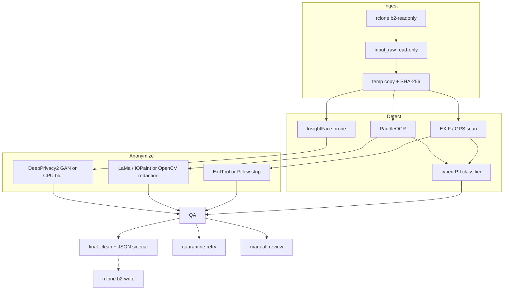

# PrivaGen

> GPU image anonymizer that never writes originals. Faces, on-image text, and EXIF stripped. JSON audit per file. Typed PII on OCR/EXIF is measured in CI.

GPU-first image anonymizer for teams that need to ship or archive a large still-photo set without leaving identity, readable text, or GPS in the files.

It does not process video, it does not write to originals, and it does not run without an explicit **Images Only** confirmation in the UI.

## Problem

A 30k–40k image drop from a field operation is not a “blur faces in Photoshop” problem. It is a pipeline problem:

- **Originals are evidence.** One accidental in-place write and the source set is tainted.
- **Identity is not only faces.** License plates, badges, EXIF GPS, Artist/UserComment, and OCR text leak as much as a portrait.
- **The GPU node dies.** CPU fallback has to keep the same audit shape or the run is unusable.
- **You cannot prove a negative from a README.** An anonymizer without measured detection quality is a demo.

PrivaGen is the control plane + batch engine I built for that job: read-only ingest, GPU GAN / OCR / inpaint with automatic CPU fallback, EXIF strip, three-way QA routing, and a typed PII layer that CI actually scores.

## Architecture



Two entry points, one orchestrator: `app.py` (Flask dashboard) calls `scripts/main_pipeline.py`. Per-image work is `scripts/batch_processor.py`. Typed PII for OCR strings and EXIF payloads is `scripts/pii_detect.py`.

Full file map: [docs/ARCHITECTURE.md](docs/ARCHITECTURE.md).

## Measured detection quality

Credibility for an anonymizer is precision/recall, not a screenshot.

**Command:** `python -m scripts.eval_pii`  
**Date (UTC):** 2026-10-19  
**Corpus:** 40 synthetic documents, 41 labeled entities (reserved test values only — no real people or client data).  
**Match:** same type and character IoU ≥ 0.5.

| Entity type | Precision | Recall | F1 | tp | fp | fn | n |
|-------------|----------:|-------:|---:|---:|---:|---:|--:|
| EMAIL | 1.000 | 1.000 | 1.000 | 7 | 0 | 0 | 7 |
| PHONE | 1.000 | 0.833 | 0.909 | 5 | 0 | 1 | 6 |
| SSN | 0.750 | 0.750 | 0.750 | 3 | 1 | 1 | 4 |
| CREDIT_CARD | 1.000 | 1.000 | 1.000 | 3 | 0 | 0 | 3 |
| LICENSE_PLATE | 1.000 | 0.750 | 0.857 | 3 | 0 | 1 | 4 |
| GPS | 1.000 | 1.000 | 1.000 | 4 | 0 | 0 | 4 |
| PERSON | 1.000 | 0.833 | 0.909 | 5 | 0 | 1 | 6 |
| ADDRESS | 1.000 | 1.000 | 1.000 | 2 | 0 | 0 | 2 |
| IP_ADDRESS | 1.000 | 1.000 | 1.000 | 1 | 0 | 0 | 1 |
| AWS_ACCESS_KEY | 1.000 | 1.000 | 1.000 | 1 | 0 | 0 | 1 |
| API_KEY | 1.000 | 1.000 | 1.000 | 2 | 0 | 0 | 2 |
| DATE_OF_BIRTH | 1.000 | 1.000 | 1.000 | 1 | 0 | 0 | 1 |
| **MICRO** | **0.974** | **0.902** | **0.937** | **37** | **1** | **4** | **41** |

Snapshot: [evals/results.json](evals/results.json). Corpus: [evals/pii_corpus.jsonl](evals/pii_corpus.jsonl).

This eval measures the **typed text/metadata detector** — the layer CI can run without CUDA. Face/body residual quality is a different gate (`python -m scripts.run_image_validation`) and needs a private photo set on a GPU host. Those images are not in git on purpose.

## Known failure modes

| Miss / false positive | What happens | Why it is left in the corpus |
|-----------------------|--------------|------------------------------|
| Undashed SSN (`123456789`) | FN | Nine-digit integers collide with order IDs and unix-ish numbers |
| Bare name (`Ada Lovelace`) | FN | No honorific / `Name:` label — PERSON is conservative by design |
| E.164 phone without `+` or separators | FN | Same collision problem as undashed SSN |
| EU plate (`AB-123-CD`) | FN | Detector is US-style (`ABC-1234`, `7XKD221`) |
| ISBN-style `123-45-6789` | FP (SSN) | Dashed triple is indistinguishable from a US SSN without a knowledge base |
| Faces / bodies / tattoos | Not scored here | Visual detectors (InsightFace, DeepPrivacy2). Synthetic ovals often miss; need real photos off-repo |
| Low-contrast / stylized on-image text | Residual OCR risk | PaddleOCR score ceiling in QA (`qa.text_det_score_fail`); LaMa can leave faint glyphs |
| XMP/MakerNote GPS if ExifTool is missing | Residual metadata risk | Pillow fallback re-encodes JPEG EXIF; install ExifTool for the strongest strip |
| Video | Out of scope | `scope.processing_mode: images_only` is locked |

## Trade-offs

| Choice | Took | Rejected | Why |
|--------|------|----------|-----|
| GPU GAN + OCR inpaint, CPU blur/redact fallback | Automatic downgrade, same sidecar schema | Fail-closed on CUDA | A 37k unattended run cannot wait for the node |
| Typed regex + Luhn PII on OCR/EXIF | Deterministic, CI-scored | LLM NER on every box | Recruiter-measurable; no key required; known misses are listed, not hidden |
| Images only | Locked in config + UI confirm | Video decode/re-encode | Audio, GOP, and subtitle PII is a different product |
| Blank-slate git | No pixels, no audit JSON in the repo | Sample faces in-tree | A public anonymizer that ships real faces is a contradiction |
| Two B2 keys, two buckets | Read-only ingest, write-only export | One powerful key | Blast radius if the GPU VM is copied |
| Deterministic QA first | Reproducible pass/fail | CrewAI-only routing | LLM rationale is optional and off unless `OPENAI_API_KEY` is set |
| Originals copied, never opened for write | `input_raw/` guard | In-place edit | Checksums of source and output in every sidecar |

## Guardrails

| Guardrail | What it means |
|-----------|---------------|
| Originals never written | `input_raw/` is guarded; every image is copied to `temp_processed/` before any pixel changes |
| Images only | `processing_mode: images_only` is locked in `config.yaml`; the UI makes the operator confirm it |
| Checksums | SHA-256 of source bytes and output bytes recorded in each JSON sidecar |
| Two-key object store | Read-only key for ingest, separate read/write key for export, separate buckets |
| `redact_logs` | Secret values are never logged — key names only |
| Empty data dirs in git | Runtime folders ship with only a `.gitkeep` |
| Human review folder | QA failures go to `manual_review/` instead of silently passing |

## Stack

Python 3.10, Flask dashboard, DeepPrivacy2, PaddleOCR, IOPaint/LaMa, InsightFace QA, ExifTool/Pillow, typed PII classifier, optional rclone + Backblaze two-key model, optional CrewAI QA if `OPENAI_API_KEY` is set. GPU first, CPU fallback automatic.

## How to run

```bash
git clone https://github.com/DannyBarren/PrivaGen-Anonymizer.git
cd PrivaGen-Anonymizer
```

**CI-equivalent (no GPU, no secrets):**

```bash
python3.10 -m venv .venv && source .venv/bin/activate
pip install -r requirements-ci.txt
pytest
python -m scripts.eval_pii
ruff check scripts/pii_detect.py scripts/eval_pii.py evals/corpus.py tests/test_pii_detect.py tests/test_pii_eval.py tests/test_metadata_strip.py tests/test_security_guards.py
```

**Operator UI:**

```bash
conda create -n privagen python=3.10 -y && conda activate privagen
pip install -r requirements-ui.txt
cp .env.example .env.local   # placeholders only; encrypt before a real B2 run
python app.py
```

Open <http://127.0.0.1:5000>. In Setup, click **Install All Dependencies** and wait for **Ready for GPU** or **Ready for CPU fallback**. Drop images into `input_raw/` locally — do not commit them. Enable **Test mode**, set max images to `5`, press **Start**.

CLI:

```bash
python -m scripts.main_pipeline --test-mode --max-images 5
python -m scripts.main_pipeline --dry-run
python -m scripts.environment_checker
python -m scripts.health_check
```

GPU residual gate (private images, never commit):

```bash
python -m scripts.run_image_validation --count 12
```

Docs: [docs/QUICKSTART.md](docs/QUICKSTART.md) · [docs/ARCHITECTURE.md](docs/ARCHITECTURE.md) · [docs/DEPLOY.md](docs/DEPLOY.md) · [docs/TROUBLESHOOTING.md](docs/TROUBLESHOOTING.md) · [evals/README.md](evals/README.md)

## What this is evidence of

- A CV pipeline with a real operator UI, not a notebook.
- GPU path plus automatic CPU fallback that still emits full JSON audits.
- Typed PII on OCR/EXIF with **measured** precision/recall and listed failure modes.
- Read-only originals, checksums, and three-way routing: clean, quarantine, manual review.
- Built to run at tens of thousands of stills (~37k-image batches) without putting the dataset in git.

## Notes

This repo ships with empty data directories. There is no sample dataset here and no images in git history. Bucket names and remote paths in `config.yaml` and `.env.example` are placeholders — set your own. Values matching `sk-your…` / `sk-MOCK…` are treated as not-real by `scripts/secrets_manager.py`.

PrivaGen is a Barren Business Development product. MIT licensed; see [LICENSE](LICENSE). You are responsible for lawful use, consent, and any biometric/PII regulation that applies to your data.
